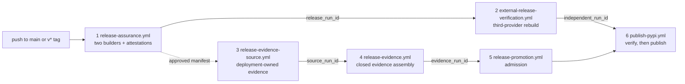

# Release runbook

A release moves through six GitHub Actions workflows. Only the first runs
automatically; the other five are manual `workflow_dispatch` stages, each
behind its own protected environment, that verify the previous stage's exact
run, commit, and digests before doing anything else. No stage trusts a value
it can re-derive, and every stage fails closed.

The [operations guide](operations.md) and
[production security](production-security.md) pages describe each control in
depth; this page is the operator checklist that ties them together.

## Before you start

- The release commit is on protected `main` (a `v*` tag must point at a commit
  already on `main`). `publish-pypi.yml` rejects any commit that is not an
  ancestor of `origin/main`.
- `## [Unreleased]` in `CHANGELOG.md` is complete. For a tagged release, move
  those entries under `## [X.Y.Z] - YYYY-MM-DD`, add a matching compare link at
  the bottom of the file, and bump `src/py_security_suite/version.py` in the
  same pull request.
- The protected environments exist with independent reviewers, no bypass, no
  self-review, and deployment restricted to `main`: `independent-release-verification`,
  `release-evidence-source`, `release-admission`, and `pypi-production`
  (audit them with `scripts/audit_github_assurance_controls.py`).
- PyPI lists this repository, the `publish-pypi.yml` workflow, and the
  `pypi-production` environment as the project's Trusted Publisher.

Record every run ID and digest below in the release ticket as you go.

## 1. Release artifact assurance (automatic)

`release-assurance.yml` runs on every push to `main` and every `v*` tag. It
re-runs detection accuracy and deep assurance, builds the wheel and sdist on
two independent pinned runners from the commit epoch, attests both outputs,
requires byte-for-byte equality, and uploads the canonical
`release-artifacts` artifact.

Record: the **run ID** (`release_run_id`), the **commit SHA**, and the wheel and
sdist **SHA-256** values from the comparison job. Only a successful first
attempt of a `push` run is accepted later.

## 2. Independent provider verification

Dispatch `external-release-verification.yml` with `release_run_id` and
`expected_head_sha`. A protected `pysec-independent-builder` runner rebuilds the
wheel and must reproduce the canonical bytes; it uploads
`independent-release-verification-<sha>`.

Record: the **run ID** (`independent_run_id`).

## 3. Governed release evidence source

The deployment's evidence producer writes the closed evidence directory to the
path in the `RELEASE_EVIDENCE_INPUT_PATH` variable and an independent approver
signs off its manifest digest. Dispatch `release-evidence-source.yml` with
`manifest_sha256`; it re-verifies the directory on the `release-evidence`
runner and uploads `release-evidence-input`.

Record: the **run ID** (`source_run_id`) and the exact **ref** it ran on.

## 4. Release evidence assembly

Dispatch `release-evidence.yml` with `source_run_id`, `manifest_sha256`,
`expected_head_sha`, and `expected_ref`. Starting from protected `main`, it
verifies the producer run before installing any repository code, re-verifies
every hardened evidence class, and emits the sole `release-evidence` artifact.

Record: the **run ID** (`evidence_run_id`).

## 5. Release promotion

Dispatch `release-promotion.yml` with `evidence_run_id`, `manifest_sha256`,
`expected_head_sha`, and `expected_ref`. It admits the closed evidence only
from the hard-pinned assembly workflow, first attempt, same commit, protected
`main`, and matching artifact digest.

## 6. PyPI publication

Dispatch `publish-pypi.yml` with `release_run_id`, `independent_run_id`,
`expected_head_sha`, `wheel_sha256`, and `sdist_sha256`.

- The `verify` job holds no OIDC permission. It requires the release run to be
  a successful first-attempt `push` of `main` or a `v*` tag, the commit to be an
  ancestor of `origin/main`, the approved digests, both provenance attestations,
  the independent wheel, and the standard-library archive verifier. It hands
  off only the verified files.
- The `publish` job runs behind `pypi-production`, holds only
  `id-token: write`, checks out no code, re-checks the digests, and publishes
  through Trusted Publishing.
- `post-publish-roundtrip` downloads both files from PyPI, re-checks their
  digests, and installs and runs the public wheel. Only after it passes may the
  release lifecycle move to `published`.

## After publishing

- Tag the commit `vX.Y.Z` if the release started from `main`, and create the
  GitHub release from the matching `CHANGELOG.md` section.
- Start a fresh `## [Unreleased]` section if the release consumed it.

## Failure handling

Every stage is safe to abandon. Do not re-run a failed attempt: later stages
accept only attempt 1. Fix the cause, land it on `main`, and restart from
stage 1 with the new commit.
